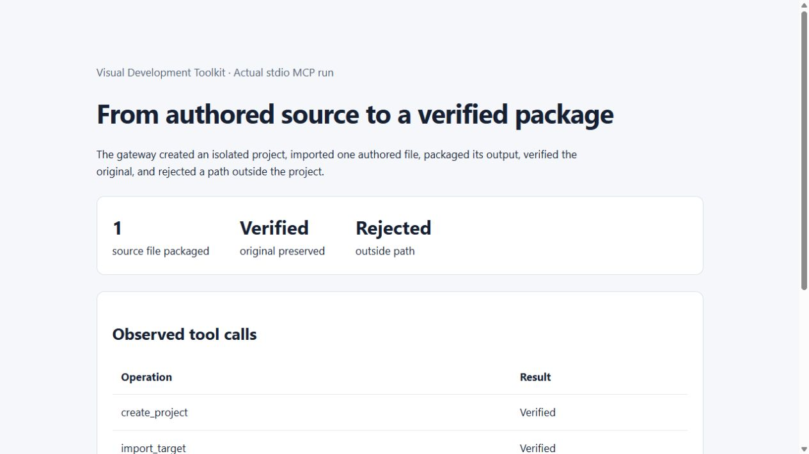
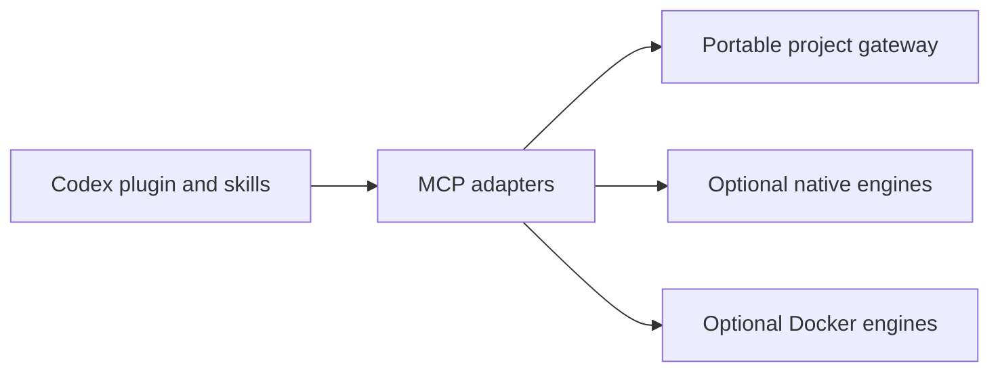

# Visual Development Toolkit

A Codex plugin integration layer for source projects, file packaging, optional asset tools, and compiled-artifact inspection. Version **1.2.0** connects MCP adapters to separately installed native Windows or Docker engines. PS5 projects are excluded.

## Demonstration



See the [reproducible walkthrough and its validation scope](docs/DEMO.md).

## Project direction and use

[Kenneth Yepez](https://github.com/kennethyepez) directs the requirements, architecture, integration, and validation of this toolkit's integration layer. AI coding agents implement code under his direction. Integrated engines retain their upstream authorship and licenses.

See [use and licensing](LICENSE.md), [contributing](CONTRIBUTING.md), and [security reporting](SECURITY.md).

## Portable quickstart

Review the source and exercise the portable MCP gateway before installing any native engine. Requires Python 3.13; the walkthrough does not start Docker, Ghidra, or REA and does not call a paid provider.

```bash
python -m venv .venv
# Activate .venv using your shell, then:
python -m pip install -r requirements-dev.txt
python -m unittest discover -s tests -v
python tools/create_demo.py
python -m http.server 8000 --bind 127.0.0.1 --directory docs/examples
```

Open `http://127.0.0.1:8000/walkthrough.html`. The example uses actual MCP stdio requests to create an isolated project, import an authored HTML file, package it, verify byte integrity, and reject a path outside the project. It does not establish native engine compatibility.

## Architecture and review



Start with [lab_mcp.py](plugins/game-modding-toolkit/server/lab_mcp.py), [native_mcp.py](plugins/game-modding-toolkit/server/native_mcp.py), and the [portable integration tests](tests/test_portable_gateway.py). The [plugin manifest](plugins/game-modding-toolkit/.codex-plugin/plugin.json) and [marketplace](.agents/plugins/marketplace.json) preserve the internal package ID `game-modding-toolkit@modding-lab` for compatibility.

## Optional engines

Choose the [Docker setup guide](docs/INSTALL-WINDOWS.md) or [native Windows guide](docs/NATIVE-WINDOWS.md) only when the target needs those engines. Inspect the Docker plan with `python setup_runtime.py --plan --build --install` before authorizing installation. The native downloader performs installation; it has no plan-only mode. Neither installer is required for the portable example.

REA's Windows native PE provider is experimental and read-only; support differs from Linux. Fal and other generation providers require separately configured credentials and can incur charges. Source publication does not authorize paid calls or work on third-party binaries.

## Provenance and historical evidence

[THIRD_PARTY.md](THIRD_PARTY.md), [upstream-lock.json](upstream-lock.json), and [native-tool-lock.json](native-tool-lock.json) identify upstream engines and pinned downloads. Their underlying capabilities and authorship are separate from this integration layer.

Machine-specific operator notes and earlier runtime checks are preserved in [docs/history](docs/history/README.md). Those records do not prove a fresh-machine installation. User projects, credentials, runtime binaries, and generated caches are excluded.
