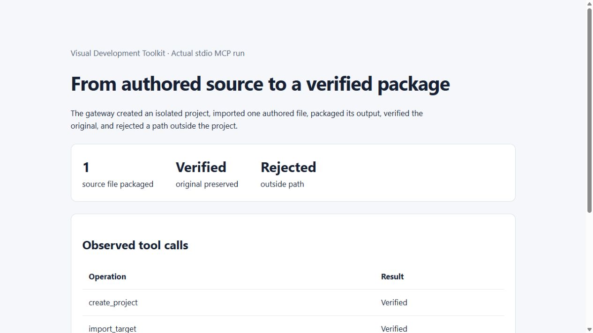

# Portable project gateway



## Reproduce

Python 3.13 and the pinned MCP 1.x package. Native and Docker engines are optional, separately validated installations.

Use an isolated checkout and environment.

```bash
python -m pip install -r requirements-dev.txt
python -m unittest discover -s tests -v
python tools/create_demo.py
```

Serve the generated files locally:

```bash
python -m http.server 8000 --bind 127.0.0.1 --directory docs/examples
```

Open `http://127.0.0.1:8000/walkthrough.html`.

## What the example establishes

The example calls the actual MCP stdio gateway. It creates an isolated project, imports an authored HTML file, packages it, verifies original bytes, and rejects an outside path. The packaged source is available in docs/examples/packaged-project/index.html. No installed plugin cache, user archive, native engine, image processing, or paid generation is used.

The screenshot records the visible output of this workflow. It does not establish behavior outside the stated scope. Generated evidence and source examples are preserved alongside the walkthrough; current CI runs provide commit-specific checks.
