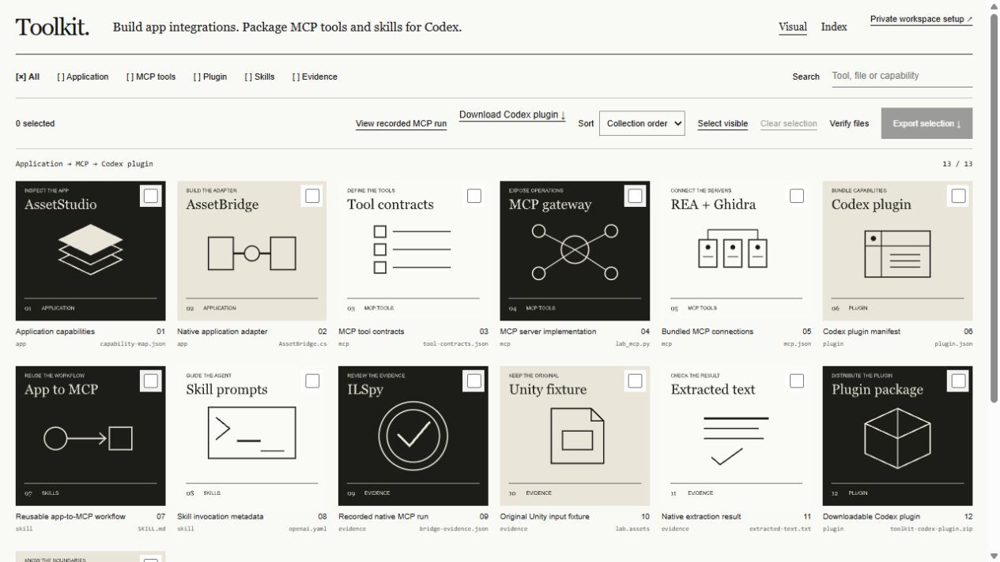
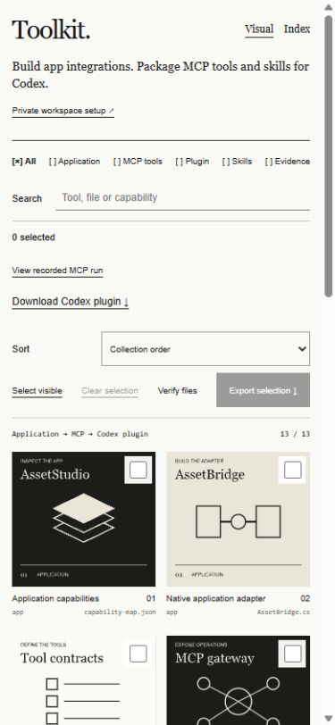

# Visual Development Toolkit — app-to-MCP showcase

[Open the integration showcase](https://kennethyepez.com/work/visual-development-toolkit/index.html) · [Reproduce the real case](APP-TO-MCP.md)

Build MCP tools around an application's native capabilities and package those tools with server connections and reusable Codex skills. The approved gallery design now presents one coherent application bridge: AssetStudio/AssetBridge, actual MCP contracts, plugin source, an app-to-mcp skill and recorded native verification.

The recorded case extracted an authored Unity TextAsset, matched the original bytes, inspected the authored adapter with ILSpy and read the result back from its package. The public interface provides real file inspection, integrity checks and plugin downloads. It distinguishes those browser actions from the saved native run.

Phone view

Private workspace access retains its existing passkey flow. The portable plugin passed a fresh isolated Codex CLI installation and real MCP calls. Human passkey enrollment and recovery acceptance remain separate. See [local setup](../demo/README.md) and [coverage](APP-TO-MCP.md#coverage).
